# OptiLogic-16 Pro

OptiLogic-16 Pro is a custom built, FPGA-based 16-channel logic analyzer and network monitor designed from scratch from PCB design and component selection to firmware development and 3D modeling.
Featuring a Xilinx Kintex-7 FPGA 500 MSa/s sampling programmable input thresholds 4 Gbit DDR3 memory three SFP ports Gigabit Ethernet and USB 3.0, it is designed for high-speed digital signal analysis, hardware debugging, and network data acquisition.

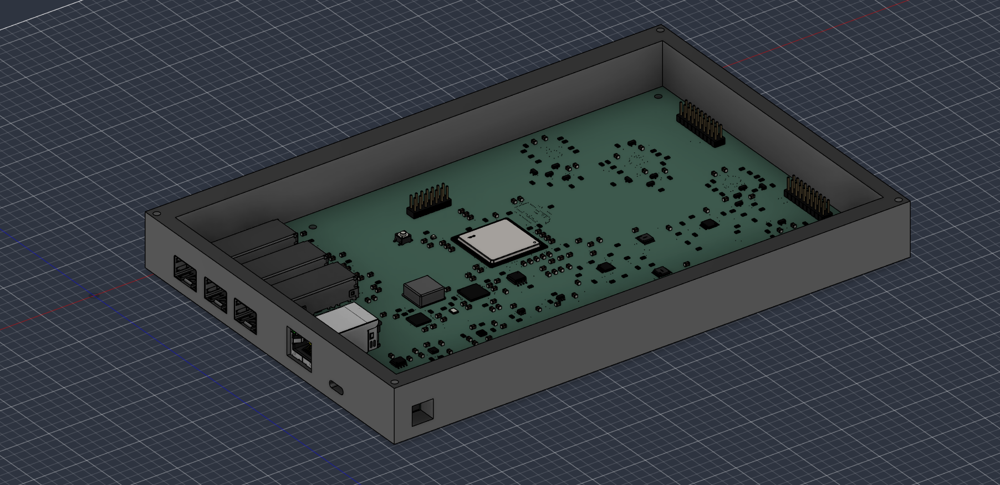

## Schematic and PCB

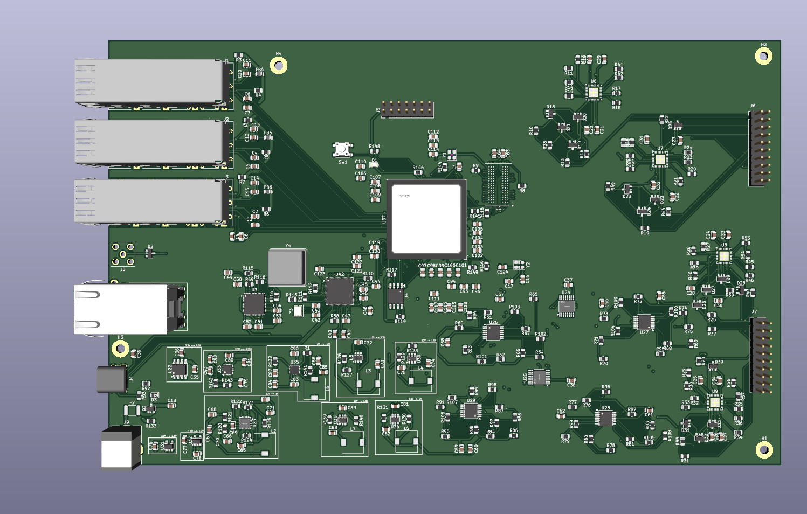
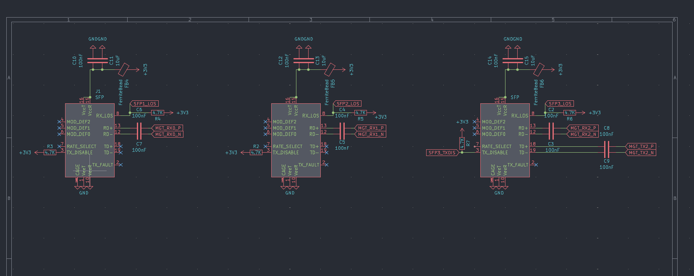
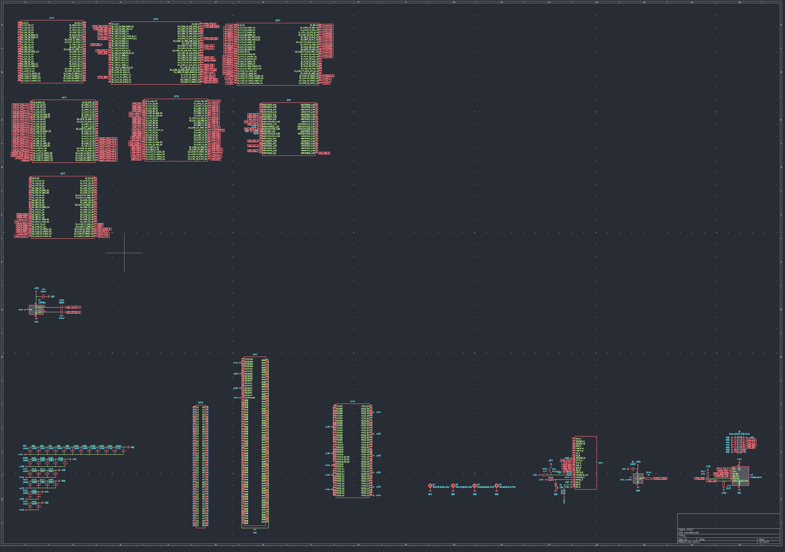
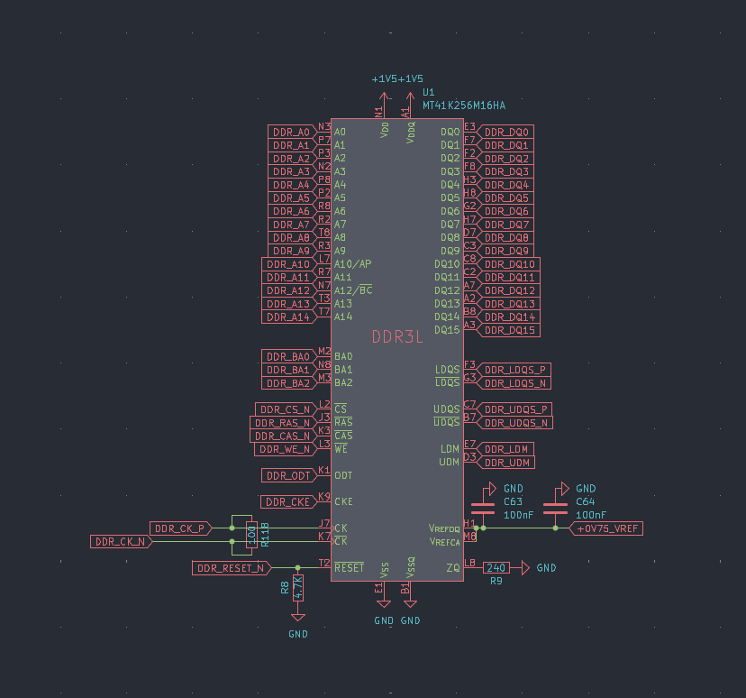
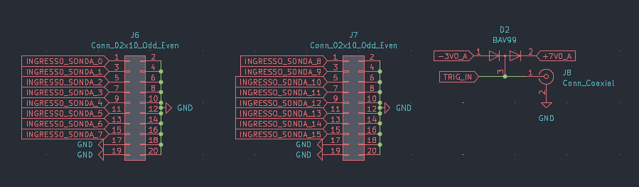
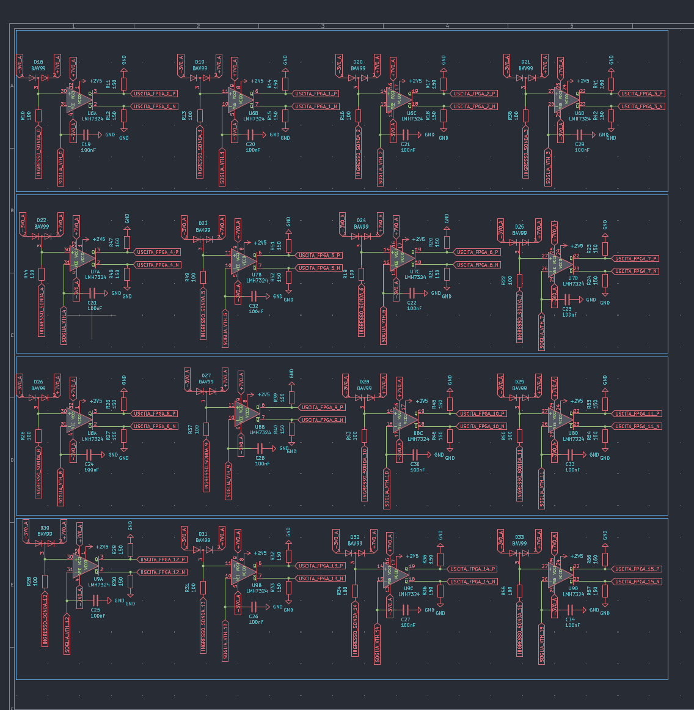
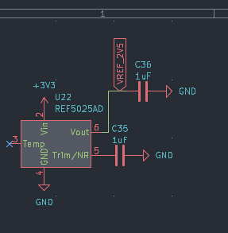
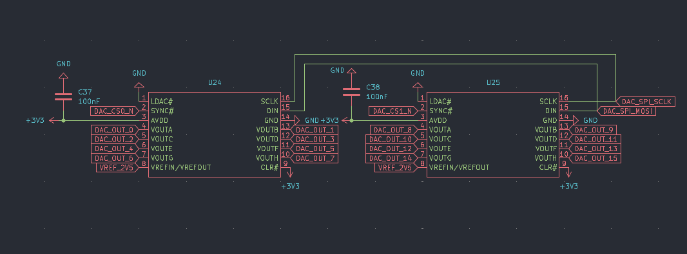
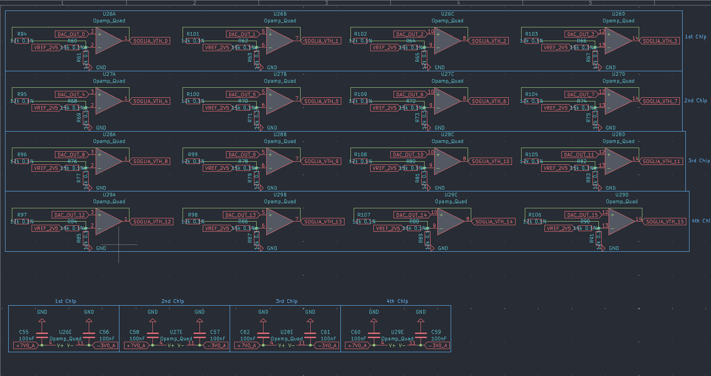
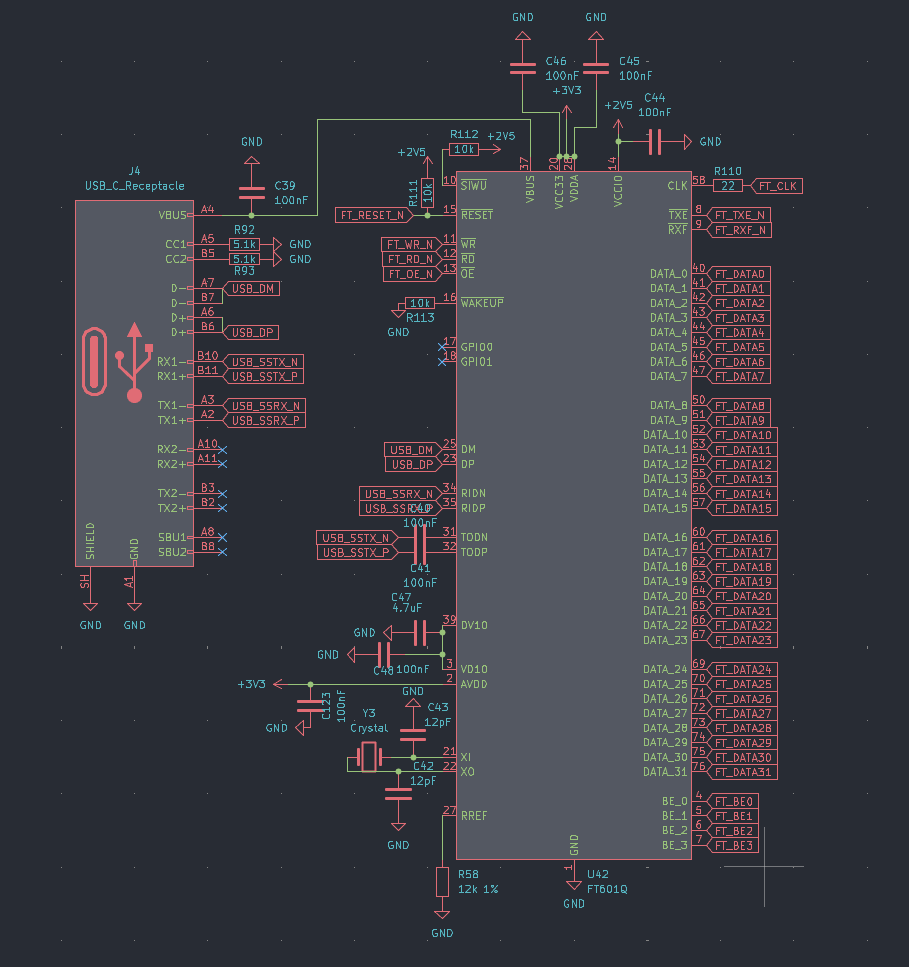
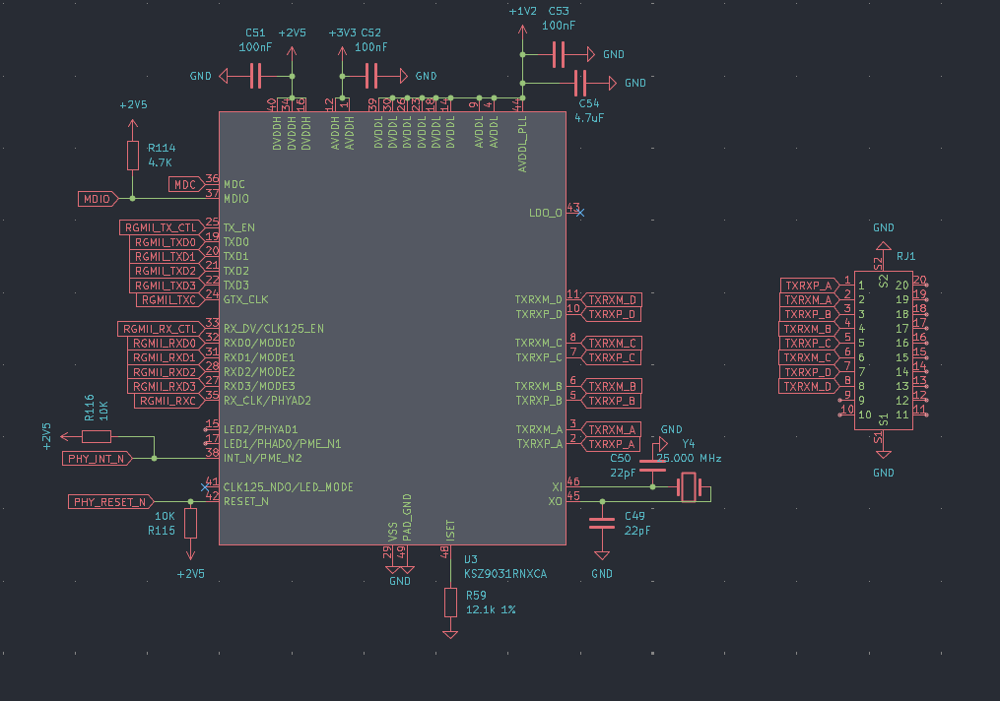
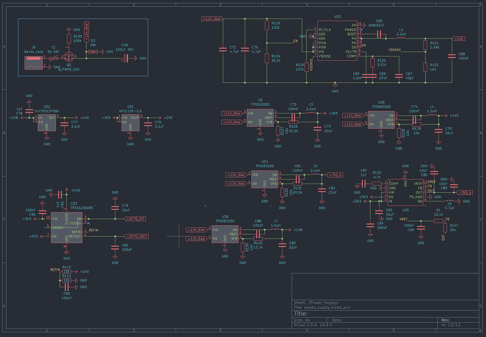

### How this was made

I designed an 8-layer PCB that has 16 digital inputs united by 4 comparators. The board runs with 12V DC current with a standard barrel jack connector:

1. 16 analog thresholds programmable from -2.0V to +5.0V.
2. A 4 Gbit DDR3 memory dedicated to sample buffering.
3. Three SFP cages for fiber optic (2 are recive only and 1 is recive and trasmit).
4. Gigabit Ethernet.
5. USB 3.0 for PC communication.

The PCB has a precise layer structure:

1. **F.Cu** is only used for local connections or high speed and GND plane
2. **In1.Cu** is used as GND plane to remove noise and interferences from the under and above layer. It is used to put traces on it if there is no space between them
3. **In2.Cu** is used for short range high speed comunication like the RAM
4. **In3.Cu** is used only to carry power with very thick copper traces
5. **In4.Cu** is the same as In1.Cu
6. **In5.Cu** used to connect the comparators and DACs between them and wire them to the FGPA
7. **In6.Cu** is the same as In3.Cu
8. **B.Cu** used as auxiliary short distance traces

### External connections breakdown

1. **12V Power**: The main barrel jack socket that powers the board portectd by a resettable fuse. The 12V input is stepped down with multiple converters and the 12V input becomes +7.0V, -3.0V, +3.3V, +2.5V, +1.8V, +1.5V, +1.2V, +1.0V required by the FPGA, comparators, and transceivers.
2. **USB-C Port**: This port supports PC communication.
3. **Logic Probes**: Two 20-pin headers handling the 16 high-speed input channels. The even pins are connected to GND.
4. **JTAG**: A 14-pin socket used to debug and flash the FPGA and the QSPI memory.

### Mechanical design and why I chose certain components

To make sure the logic analyzer can sample at 500 MSa/s without struggling with signal integrity, I had to select specialized components:

* **FPGA (Xilinx Kintex-7 XC7K70T-2FBG676I)**: I choose the FBG676 package because it provides enough I/O pins to drive everything that is on the board.
* **Comparators (LMH7324)**: Selected for their 700 ps rise/fall times. By powering their output stage (`VCCO`) at +2.5V, the RSPECL outputs naturally shift to LVDS levels, allowing direct connection to the FPGA without complex external resistor networks.
* **USB Bridge (FTDI FT601Q)**: I avoided using a PCIe interface or a complex FPGA-based USB PHY. The FT601Q provides a 32-bit synchronous 245 FIFO interface running at 100 MHz, easily sustaining ~380 MB/s of real-world bandwidth to the host PC.
* **DACs (TI DAC8568)**: Chosen to provide 16 independent threshold voltages. A single SPI bus configures both chips, and precision Op-Amps scale the 0–2.5V output to the required -2.0V to +5.0V range.

### How to flash the firmware

My project doesn't have a built-in USB-to-JTAG programmer. To flash the firmware you need a Xilinx Platform Cable USB or a JTAG adapter wired to the connector. You must use the AMD/Xilinx Vivado Design Suite to upload the firmware into the QSPI Flash.

### Steps to reproduce:

**In AMD/Xilinx Vivado (Compilation):**

1. Install Vivado 2023.2 (or newer).
2. Open the project and go to the settings to select the target device `XC7K70T-2FBG676I`.
3. Add the Verilog sources and the XDC file.
4. Run Synthesis and Implementation from the left panel.
5. Click on Generate Bitstream.
6. Open the Tcl Console and paste the following command to export the compiled binary for the QSPI Flash:
`write_cfgmem -format bin -interface spix4 -size 16 -loadbit "up 0x0 ./project_name.runs/impl_1/optilogic_16_pro_top.bit" -file ./optilogic_16_pro_flash.bin`

**In Vivado Hardware Manager (Flashing):**

1. Insert the JTAG programmer into the PC and connect it to the header on the board.
2. Connect the 12V power supply.
3. In Vivado, click "Open Hardware Manager" ensure that the programmer is selected, and click "Auto Connect".
4. Right-click the `xc7k70t_0` device and select "Add Configuration Memory Device".
5. Search for the `w25q128-spi-x1_x2_x4` part and select it.
6. Go to the programming tab select the previously exported `.bin` file ensure "Erase, Program, Verify" is selected, and click "Start Programming". If everything goes right you'll see a success message. Power-cycle the board to boot the firmware.

### Filament and Thermal recommendation

The Kintex-7 FPGA, FT601Q bridge, KSZ9031 PHY, and switching regulators generate a lot of heat (50°C–60°C) during continuous sampling. The LMH7324 comparators also dissipate heat into the PCB internal GND plane. To dissipate the thermal load and shield the board from radio frequency interference the board must be enclosed in a CNC-machined aluminum case.
I suggest using these settings on JLCPCB before putting it into production
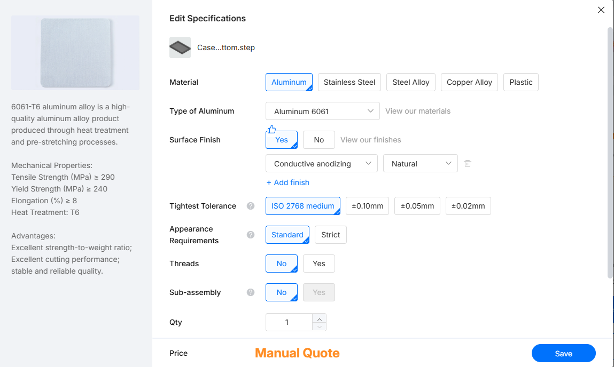

### ⚠️⚠️ Safety advice ⚠️⚠️

This project includes experimental software and hardware designs. Assembly documentation and firmware are still under development and may contain bugs, errors, or incomplete features. By using, building, or modifying this project, you acknowledge that:

1. You use this project entirely at your own risk.
2. You are solely responsible for safe assembly, testing, and operation.
3. The author isn't responsible for any type of damage, injury, or loss to people or the machine itself.

By proceeding, you accept all risks and agree to these conditions. If you do not acknowledge these risks and conditions, please do not use or build this project.
